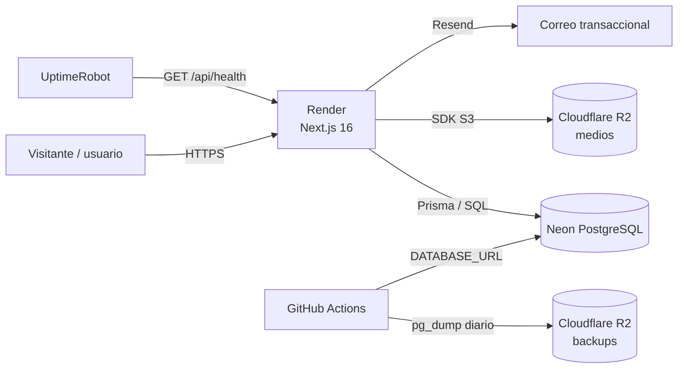

# Documentación técnica — Marketplace UniSalamanca

**Versión:** 1.0  
**Fecha:** 24 de noviembre de 2026  
**Repositorio:** `unisalamanca-marketplace`  
**Aplicación:** Marketplace del Consultorio Empresarial Winner — Universidad de Salamanca Colombia

---

## 1. Resumen ejecutivo

Marketplace UniSalamanca es una plataforma web que conecta a **empresas, estudiantes, emprendedores, agremiaciones y docentes** para:

- Publicar **prácticas profesionales** y oportunidades **B2B** (ofertas y solicitudes de servicios entre empresas).
- Postularse con mensaje, enlaces y hoja de vida.
- Mostrar el **directorio del ecosistema Winner** con perfiles públicos verificables.
- Publicar **ventures** (spin-offs y startups) con estado, sector y etapa.
- Difundir **noticias y eventos** con avisos por correo.
- Moderar contenido, reportes y roles desde un panel de administración.

El proyecto está construido con un stack 100 % gratuito para despliegue: **Render + Neon + Cloudflare R2 + GitHub Actions + UptimeRobot**.

---

## 2. Stack tecnológico

| Capa | Tecnología | Versión / detalle |
|---|---|---|
| Framework | Next.js (App Router) | `16.4.6` |
| UI | React | `19.3.0` |
| Lenguaje | TypeScript | `5.x` |
| Estilos | Tailwind CSS + `@tailwindcss/turbopack` | `4` |
| Iconos | lucide-react | `1.61.0` |
| Base de datos | PostgreSQL en Neon | Plan Free |
| ORM | Prisma | `5.22.0` |
| Autenticación | better-auth | `1.7.16`, correo y contraseña |
| Almacenamiento | Cloudflare R2 / S3 compatible | AWS SDK `3.x` + presigned URLs |
| Procesamiento de imágenes | sharp | `0.35.5` |
| Correo | Resend | Opcional; con fallback a consola |
| Contenido | react-markdown | `10.1.0` |
| Pruebas unitarias | Vitest | `5.1.0` |
| Pruebas E2E | Playwright | `1.64.1` |
| Lint | ESLint + `eslint-config-next` | `9` |
| CI / tareas | GitHub Actions | Copia diaria |
| Monitor | UptimeRobot | HTTP check sobre `/api/health` |
| Runtime en producción | Node.js | `22` (definido en `render.yaml`) |

### Lenguajes y formatos que intervienen

- **TypeScript / TSX**: aplicación, server actions, componentes y librerías.
- **SQL**: migraciones de Prisma y consultas de verificación.
- **CSS**: Tailwind CSS 4.
- **YAML**: `render.yaml` y `.github/workflows/backup.yml`.
- **Markdown**: documentación y contenido.
- **JavaScript (Node)**: scripts de administración y semillas.
- **PowerShell / Bash**: comandos locales y del workflow.

### Programas y servicios que se usan

- **Local:** Node.js 22+, npm, Git, editor de código (VS Code recomendado), Prisma Studio, Playwright.
- **Nube:** Render, Neon Console, Cloudflare Dashboard, Resend, GitHub, UptimeRobot.
- ** apoyo:** `psql`/`pg_dump`/`pg_restore`, AWS CLI para copias, navegador para QA.

---

## 3. Arquitectura general



### Principios de la arquitectura

1. **Servidor primero:** las reglas de negocio y la autorización viven en server actions y rutas API, no en el navegador.
2. **Storage remoto obligatorio en producción:** sin `S3_BUCKET` las subidas fallan; `.uploads/` existe solo para desarrollo.
3. **Seguridad por capas:** sesión validada en servidor, roles verificados, CSRF por `Origin`, rate limits persistentes y cabeceras de seguridad.
4. **Operación barata y reproducible:** migraciones automáticas en Render, copias en GitHub Actions y monitorización externa.

---

## 4. Estructura del repositorio

```text
app/                         Rutas de la aplicación (App Router)
  api/auth/[...all]/         Endpoint de better-auth
  api/health/                Comprobación de salud para UptimeRobot
  api/cuenta/foto/           Subida de foto de perfil
  api/publications/…/media/  Presign, confirmación y borrado de medios
  api/applications/[id]/cv/  Descarga segura de hoja de vida
  publicaciones/             Listado, detalle, creación, edición, postulaciones y reportes
  ventures/                  Spin-offs y startups
  directorio/                Directorio público del ecosistema
  noticias/                  Noticias y eventos
  cuenta/                    Perfil, publicaciones, postulaciones, guardados, notificaciones
  admin/                     Moderación, usuarios, reportes y noticias
  terminos/ privacidad/ contacto/   Páginas legales (borrador)
components/                  Componentes reutilizables de interfaz
lib/                         Prisma, auth, roles, permisos, email, storage, imágenes, notificaciones
prisma/schema.prisma         Modelo de datos
prisma/migrations/           Migraciones versionadas
scripts/                     Utilidades de consola (admin y seed)
tests/                       Pruebas unitarias con Vitest
e2e/                         Pruebas de extremo a extremo con Playwright
render.yaml                  Blueprint de Render
.github/workflows/backup.yml Copia diaria de PostgreSQL a R2
render-import.env.example    Plantilla de variables para Render (sin valores reales)
```

---

## 5. Áreas funcionales

### 5.1 Público

| Ruta | Qué hace |
|---|---|
| `/` | Portada y accesos principales |
| `/publicaciones` | Listado con filtros, paginación y detalle por slug |
| `/ventures` | Listado de spin-offs y startups |
| `/directorio` | Directorio del ecosistema Winner con filtros, paginación y `?ver=` / `?page=` |
| `/noticias` | Noticias y eventos |
| `/terminos`, `/privacidad`, `/contacto` | Textos legales y contacto (marcados como borrador) |

### 5.2 Autenticación y cuenta

| Ruta | Qué hace |
|---|---|
| `/login`, `/registro` | Acceso y registro por correo y contraseña |
| `/recuperar`, `/restablecer` | Recuperación de contraseña |
| `/cuenta` | Resumen de la cuenta |
| `/cuenta/perfil` | Datos personales |
| `/cuenta/perfil-profesional` | Perfil profesional y hoja de vida |
| `/cuenta/publicaciones` | Publicaciones propias |
| `/cuenta/postulaciones` | Postulaciones enviadas y recibidas |
| `/cuenta/guardados` | Publicaciones, ventures y miembros guardados; también ocultos |
| `/cuenta/directorio` | Edición del perfil público del directorio |
| `/cuenta/notificaciones` | Avisos internos con contador de no leídas |

### 5.3 Administración

| Ruta | Qué hace |
|---|---|
| `/admin/publicaciones` | Aprobar o rechazar publicaciones |
| `/admin/ventures` | Aprobar o rechazar ventures |
| `/admin/usuarios` | Promover o retirar roles; revisar estados |
| `/admin/reportes` | Resolver, descartar o retirar publicaciones reportadas |
| `/admin/reportes/ventures` | Igual para ventures |
| `/admin/reportes/directorio` | Igual para perfiles del directorio |
| `/admin/noticias` | Crear, editar y publicar noticias |

Las rutas de administración responden **404** a quien no es administrador: no se revela su existencia.

---

## 6. Modelo de datos resumen

El esquema completo está en `prisma/schema.prisma`. Los grupos son:

### Identidad y control de acceso

- `users`: correo único, nombre, `role`, `status`, verificación de correo, perfil público y preferencias.
- `account`, `session`, `verification`: tablas de better-auth. El hash real de la contraseña está en `account.password`.
- `role_changes`: auditoría de promociones y retiros de administrador.
- `rateLimit`: contadores de intentos persistentes en base de datos.

### Catálogos

- `areas_of_expertise`, `sectors`, `careers`, `publication_types`.
- Tablas puente: `publication_areas`, `publication_careers`, `publication_sectors`, `venture_areas`, `directory_profile_areas`.

### Contenido

- `publications` + `publication_media`: ofertas, prácticas, imágenes y videos.
- `ventures`: spin-offs y startups con sector, modelo, TRL y estado.
- `directory_profiles`: perfil público del ecosistema, visible solo si está activo y marcado como visible.
- `news`: noticias y eventos con control de envío de correos.

### Interacción y moderación

- `applications` + `application_files`: postulaciones con CV almacenado aparte.
- `publication_marks`, `venture_marks`, `directory_marks`: guardados y ocultos por usuario.
- `publication_reports`, `venture_reports`, `directory_reports`: reportes con motivo, detalle y revisor.
- `notifications`: avisos internos con enlace y fecha de lectura.

### Estados relevantes

- Publicaciones: `draft`, `in_review`, `published`, `closed`, `rejected`.
- Usuarios: `pending`, `active`, `suspended`.
- Roles: `student`, `teacher`, `company`, `association`, `entrepreneur`, `admin`.
- Reportes: `open`, `resolved`, `dismissed` (según el modelo).

---

## 7. Flujos críticos

### 7.1 Registro, verificación y acceso

1. El registro usa correo y contraseña; `requireEmailVerification: true`.
2. `admin` no se puede elegir al registrarse: `lib/roles.ts` y los hooks de better-auth descartan `role` y `status` enviados por el cliente.
3. Las cuentas nuevas quedan `pending` hasta activación; el cambio de correo exige confirmación en dos pasos.
4. Los límites de intentos viven en la tabla `rateLimit`, compartida entre instancias.

### 7.2 Publicaciones y postulaciones

1. Solo roles autorizados con cuenta activa pueden crear publicaciones.
2. Guardar en borrador o enviar a revisión; editar una publicación ya publicada la devuelve a `in_review`.
3. Postular exige cuenta activa, plazo vigente, mensaje de 20–2000 caracteres, consentimiento y CV válido cuando aplica.
4. El CV se valida por extensión y firma real, se guarda separado y su descarga está restringida a postulante, autor o administrador.
5. Aceptación, rechazo y nuevas postulaciones generan aviso interno y correo.

### 7.3 Medios

- **Remoto (producción):** `presign` → subida directa desde el navegador → `confirm` valida clave, tamaño, MIME y firma real → `sharp` re-codifica y genera miniatura WebP.
- **Local (desarrollo):** multipart a `.uploads/`, servido por `/media/[...key]`.
- Imágenes: JPG/PNG/WebP hasta 5 MB; videos MP4/WebM hasta 50 MB; máximo 10 archivos por publicación.
- Las imágenes se limitan a 2000 px y se eliminan metadatos EXIF/GPS.

> Nota operativa: la subida de foto de perfil (`/api/cuenta/foto`) va por servidor, no por URL firmada. Por eso depende directamente de que `S3_ENDPOINT`, `S3_ACCESS_KEY_ID` y `S3_SECRET_ACCESS_KEY` sean reales, no marcadores de la plantilla.

### 7.4 Reportes y moderación

1. Un usuario activo puede reportar contenido ajeno; un reporte por usuario y contenido.
2. El panel de administración permite resolver, descartar o retirar el contenido.
3. Retirar marca el contenido como `rejected`, cierra reportes abiertos y notifica a autor y reportantes.
4. El mismo patrón existe para publicaciones, ventures y directorio.

### 7.5 Roles administrativos

- Promoción y retiro desde `/admin/usuarios` o desde consola con `npm run admin:promote` / `admin:demote`.
- No se puede quitar el propio rol ni dejar cero administradores.
- Cada cambio escribe `role_changes` con usuario afectado y actor.

### 7.6 Copias de seguridad

- `.github/workflows/backup.yml` corre cada día a las 05:17 UTC.
- Usa `pg_dump --format=custom` dentro de un contenedor `postgres:17` y sube el volcado a `unisalamanca-backups`.
- Si falta alguno de los secretos `BACKUP_*`, el workflow termina con un aviso y no falla.
- `BACKUP_HEARTBEAT_URL` permite avisar a UptimeRobot cuando la copia termina.

---

## 8. Seguridad

| Mecanismo | Dónde | Qué protege |
|---|---|---|
| Verificación obligatoria | `lib/auth.ts` | Cuentas falsas o incorrectas |
| Anti-escalada de roles | `lib/roles.ts`, hooks de better-auth | Registro como `admin` |
| Admin oculto | `lib/permissions.ts` | Rutas `/admin/*` responden 404 |
| Auditoría de roles | `role_changes` | Trazabilidad de promociones |
| CSRF por `Origin` | `lib/origin.ts` | Mutaciones API desde otros sitios |
| Rate limits en DB | `lib/auth.ts` | Fuerza bruta y spam |
| Redirecciones seguras | `lib/redirect.ts` | Open redirects |
| Cabeceras HTTP | `next.config.ts` | CSP, frame-ancestors, nosniff, HSTS |
| Imágenes sin EXIF | `lib/media-processing.ts` | Privacidad de ubicación |
| CV validado y restringido | `lib/cv-file.ts`, API de CV | Archivos maliciosos y acceso indebido |

---

## 9. Variables de entorno

Solo nombres; **ningún valor real se versiona**.

| Grupo | Variables | Secretas |
|---|---|---|
| Aplicación | `DATABASE_URL`, `BETTER_AUTH_SECRET`, `BETTER_AUTH_URL`, `NEXT_PUBLIC_APP_URL`, `NODE_VERSION` | `DATABASE_URL`, `BETTER_AUTH_SECRET` |
| Correo | `SMTP_HOST`, `SMTP_PORT`, `SMTP_SECURE`, `SMTP_USER`, `SMTP_PASSWORD`, `RESEND_API_KEY`, `EMAIL_FROM`, `CONTACT_EMAIL` | `SMTP_PASSWORD`, `RESEND_API_KEY` |
| Medios | `S3_BUCKET`, `S3_ENDPOINT`, `S3_REGION`, `S3_ACCESS_KEY_ID`, `S3_SECRET_ACCESS_KEY`, `MEDIA_PUBLIC_URL` | `S3_ACCESS_KEY_ID`, `S3_SECRET_ACCESS_KEY` |
| Backups | `BACKUP_S3_ENDPOINT`, `BACKUP_S3_BUCKET`, `BACKUP_S3_ACCESS_KEY_ID`, `BACKUP_S3_SECRET_ACCESS_KEY`, `BACKUP_HEARTBEAT_URL` | Las credenciales `BACKUP_S3_*` |
| Pruebas | `E2E_BASE_URL`, `CI` | No |

- `.gitignore` ignora `.env*`, `render-import.env`, `.uploads/` y artefactos de pruebas.
- `render.yaml` declara las variables del servicio; `generateValue: true` crea `BETTER_AUTH_SECRET`.
- El workflow de copias lee los secretos desde GitHub Actions, no desde `vars`.

---

## 10. Comandos principales

| Comando | Uso |
|---|---|
| `npm install` | Instala dependencias y ejecuta `prisma generate` |
| `npm run dev` | Desarrollo en `http://localhost:3000` |
| `npm run build` | Build de producción |
| `npm start` | Arranca la app ya construida |
| `npm run lint` | ESLint |
| `npm run typecheck` | Comprobación de tipos |
| `npm test` | Pruebas unitarias (Vitest) |
| `npm run test:watch` | Vitest en modo watch |
| `npm run test:e2e` | Pruebas E2E (Playwright) |
| `npm run test:e2e:ui` | Playwright interactivo |
| `npm run db:deploy` | Aplica migraciones en producción |
| `npm run db:migrate` | Crea una migración en desarrollo |
| `npm run db:status` | Estado de migraciones |
| `npm run db:seed` | Carga catálogos de ejemplo |
| `npm run db:studio` | Explorador visual de Prisma |
| `npm run admin:promote -- correo@dominio` | Promueve a administrador |
| `npm run admin:demote -- correo@dominio` | Retira el rol de administrador |

Antes de E2E por primera vez: `npx playwright install chromium`.

---

## 11. Despliegue

### Render

- Blueprint: `render.yaml`.
- Build: `npm ci && npm run build`.
- Start: `npm run db:deploy && npm start`.
- Health check: `/api/health`.
- Plan Free, región Oregon. Se duerme tras inactividad; UptimeRobot lo despierta.

### Neon

- Rama principal de producción y rama de desarrollo separadas.
- 1 GB incluidos en el plan Free; sin backups automáticos.
- Cadena de conexión con SSL en `DATABASE_URL`.

### Cloudflare R2

- `unisalamanca-media`: imágenes y videos; acceso público vía dominio `r2.dev` o custom domain.
- `unisalamanca-backups`: volcados diarios con retención sugerida de 30 días.
- Tokens separados por bucket con permisos **Object Read & Write**.
- CORS en el bucket de medios: `PUT` y cabecera `Content-Type`.

### Correo

- Proveedores en orden de prioridad: SMTP → Resend → consola.
- SMTP recomendado con Gmail: `smtp.gmail.com`, puerto `587`, `SMTP_SECURE=false`, usuario y contraseña de aplicación de 16 caracteres. Los espacios que muestra Gmail se eliminan al leer `SMTP_PASSWORD`.
- Gmail exige que `EMAIL_FROM` use el usuario autenticado; el código lo ajusta automáticamente si detecta otro remitente.
- Resend requiere un dominio propio verificado con SPF y DKIM; `onboarding@resend.dev` solo envía al correo de la cuenta de Resend.
- Sin ningún proveedor, los correos se imprimen en consola (útil en desarrollo).
- `sendBatchEmails` usa el endpoint de lotes de Resend; con SMTP envía uno por uno y aísla los fallos.

### UptimeRobot

- Monitor HTTP cada 5 minutos sobre `/api/health`.
- Alerta por correo tras fallos consecutivos.
- Opcional: heartbeat para el job de copias.

### GitHub Actions

- Workflow `Copia de seguridad`, diario y ejecutable a mano.
- Requiere secretos `DATABASE_URL` y `BACKUP_S3_*`.

---

## 12. Verificación y calidad

Checklist usado antes de publicar:

1. `npm run typecheck`, `npm run lint`, `npm test`, `npm run test:e2e`, `npm run build` en verde.
2. `npm run db:status` sin migraciones pendientes.
3. Al menos una cuenta administradora activa y verificada.
4. `/api/health` responde `200` con `database: ok`.
5. Subida real de imagen y video; URL pública cargable.
6. Correo real de verificación, recuperación y avisos.
7. Textos legales revisados por la universidad.
8. Copia diaria creada y restauración probada.
9. Monitor activo y errores 5xx revisados.

### Pruebas existentes

- **Unitarias:** 16 archivos en `tests/` cubren roles, guards de autenticación, errores, fechas, correo por SMTP y por lotes, listado, medios, noticias, origen/CSRF, paginación, perfil, publicaciones, consultas y reportes.
- **E2E:** `smoke`, `listado`, `directorio`, `perfil` y `noticias`; crean datos propios con correos `e2e.*` y los limpian al terminar. No ejecutar contra producción.

---

## 13. Decisiones destacadas

- **Panel de administración oculto:** 404 en vez de “acceso denegado”.
- **Auditoría completa de roles** en `role_changes`.
- **Verificación obligatoria de correo**.
- **Rate limits persistentes** en base de datos.
- **Privacidad de imágenes:** re-encode sin EXIF/GPS.
- **CV separado** del registro de postulación para no cargar listados.
- **Revisión obligatoria tras editar** contenido ya publicado.
- **Correo tolerante a fallo:** las notificaciones internas no dependen de Resend.
- **Storage remoto obligatorio** en producción; el modo local es solo de desarrollo.

---

## 14. Limitaciones y pendientes

- Textos de términos, privacidad y contacto siguen marcados como **borrador** hasta aprobación universitaria.
- Render Free duerme tras inactividad: la primera petición puede tardar cerca de un minuto.
- Neon Free no incluye copias automáticas: dependencia del workflow diario.
- No hay workflow de CI que ejecute tests; solo el de backups.
- `users.password_hash` existe por compatibilidad pero no se usa; el hash real está en `account.password`.
- El directorio acota resultados; la paginación mitiga el límite.
- Los secretos R2 compartidos en el chat deben considerarse comprometidos y rotarse.

---

## 15. Glosario rápido

| Término | Significado |
|---|---|
| Server action | Función del servidor invocada desde un formulario o componente |
| Presigned URL | URL firmada que permite subir al bucket sin exponer credenciales |
| B2B | Operación entre empresas: oferta o solicitud de servicios |
| Spin-off / venture | Empresa derivada o startup del ecosistema universitario |
| TRL | *Technology Readiness Level*, nivel de madurez tecnológica |
| CSP | *Content Security Policy*, política de seguridad del navegador |
| CSRF | Ataque que fuerza acciones desde otro sitio |
| Heartbeat | Monitor que espera una señal periódica del job de copias |

---

## 16. Mantenimiento recomendado

- Revisar semanalmente `/api/health`, errores 5xx y copias creadas.
- Rotar tokens de R2 y Resend periódicamente.
- Probar una restauración de PostgreSQL cada mes en una base vacía.
- Verificar mensualmente que las fotos y archivos públicos cargan desde `MEDIA_PUBLIC_URL`.
- Actualizar dependencias con cautela, empezando por Next.js y Prisma.
- No ejecutar E2E contra producción.
